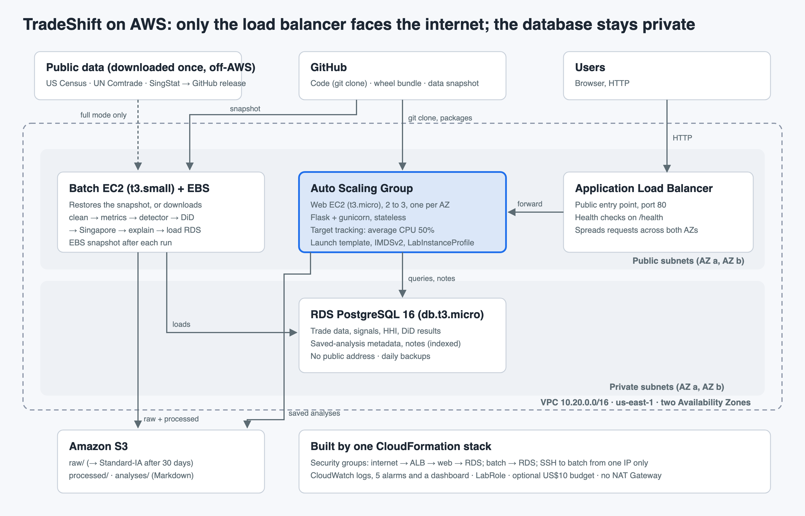
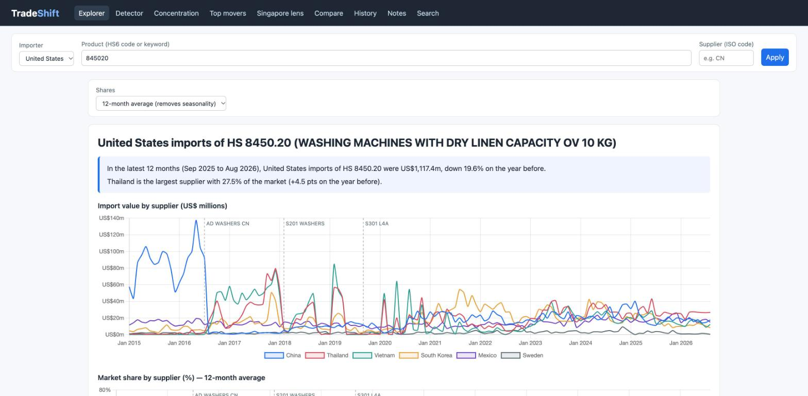
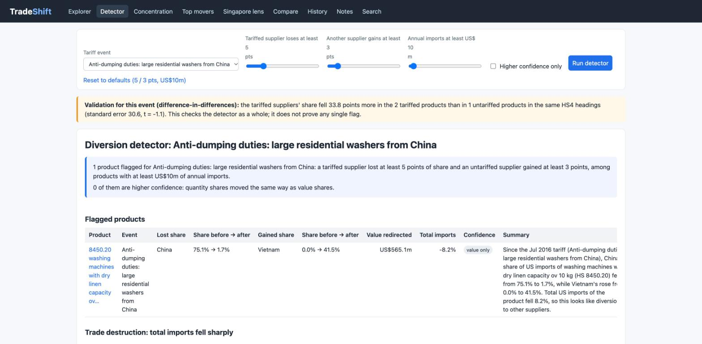
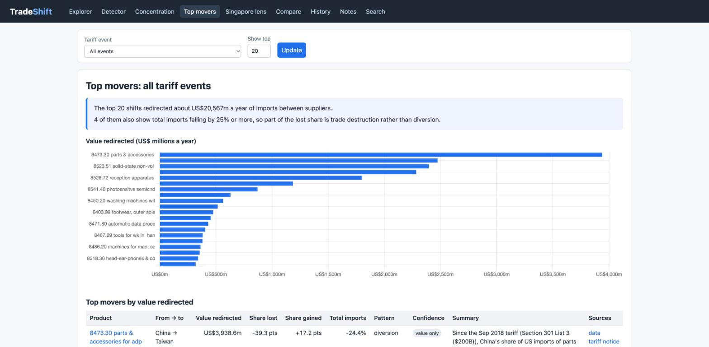
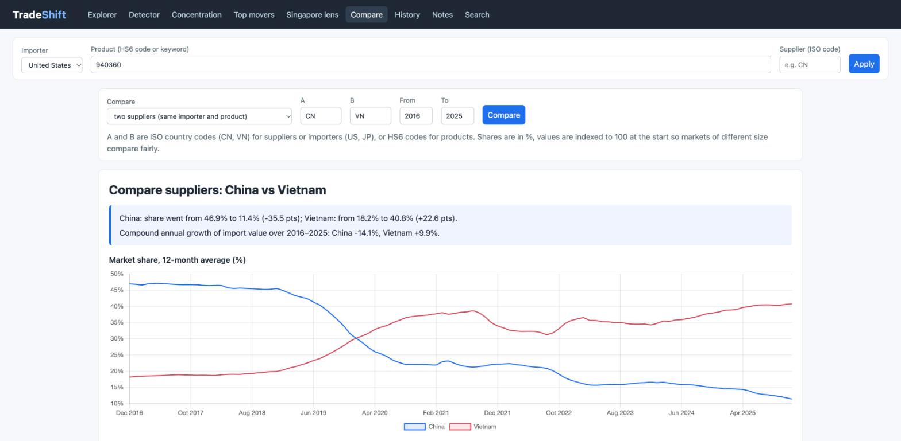
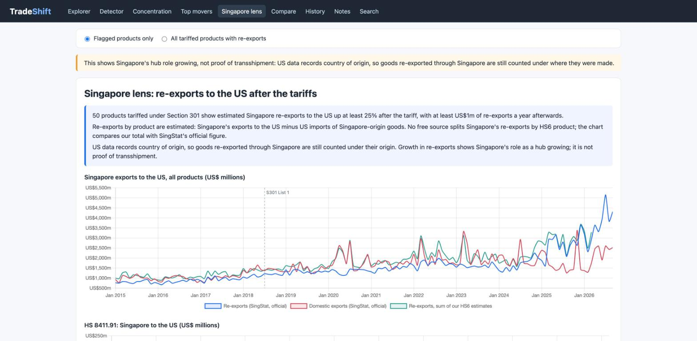
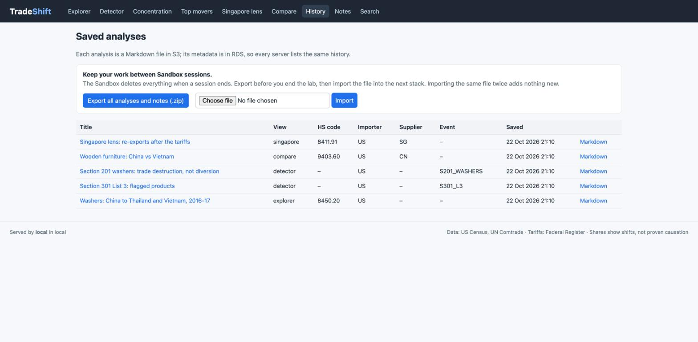

# TradeShift

**Where did trade go when the tariffs hit?** TradeShift flags products where a tariffed
supplier lost share of US imports and another country gained it. It measures how
concentrated each product's sourcing is, explains every shift in one plain sentence, and
shows where Singapore's re-exports grew. It runs on AWS from one CloudFormation stack.

DS600 Cloud Computing for Economics, group project.

- **Never used AWS?** Follow [WALKTHROUGH.md](WALKTHROUGH.md): every click, in plain words.
- **Deploying it?** Follow [RUNBOOK.md](RUNBOOK.md). Every console step has a check after it.
- **Presenting it?** Start with [the architecture diagram](docs/architecture-diagram.png) and [docs/design_choices.md](docs/design_choices.md).
- **Checking results?** See [docs/testing.md](docs/testing.md) and [docs/report.md](docs/report.md).



## What it does

| # | Course feature | Where in TradeShift |
|---|---|---|
| 1 | One-screen UI, formatted numbers, summary + source | Shared filter bar on every page; numbers formatted by `app/formatting.py` (US$ millions, %, HHI 0–10,000); every signal has a sentence and a **data** and **tariff notice** link |
| 2 | Comparison on a normalised basis | **Compare** page: two suppliers, two products or two importers; share, YoY growth, CAGR, HHI change; values indexed to 100 |
| 3 | Save previous analysis | **Save analysis** on every page writes Markdown to S3; **History** reopens it exactly, and **Export / Import** keeps saved work across Sandbox sessions |
| 4 | Save user notes | Notes box on every product and saved analysis, stored in RDS |
| 5 | Database with metadata search | **Search** page filters analyses and notes by HS code, importer, supplier, event, date (indexed; shows query time) |
| 6 | Auto scaling | Auto Scaling Group behind the ALB, target tracking at 50% CPU; `scripts/load_test.py` |

Extra credit (our proposal): **Explorer** (value and share by importer, supplier, HS6, monthly),
**Detector** (threshold sliders, quantity check for confidence), **Concentration** (HHI before and
after each tariff), **Top movers** (top 20 by value redirected, with diversion vs trade destruction),
**Singapore lens** (re-export growth, with the "hub growth, not transshipment" note).

## Screens

| | |
|---|---|
|  Explorer: washers, China's share collapses at the 2016 anti-dumping duties |  Detector with sliders, DiD box, one-line summary |
|  Top movers by value redirected |  Compare: China vs Vietnam in wooden furniture |
|  Singapore lens with the official SingStat totals |  History with Export / Import |

## How it works

```
Census API ─┐                       ┌─> S3 raw/ (each file downloaded once)
Comtrade ───┼─> batch EC2 (+EBS) ───┼─> S3 processed/ ──> snapshot on GitHub release
            │   clean → metrics →   └─> RDS PostgreSQL (private subnets)
            │   detector → DiD →                 ▲
            │   singapore → explain              │ queries, notes, analysis metadata
            │                                    │
Users ──HTTP──> ALB ──> Auto Scaling Group of web EC2 (Flask + gunicorn) ──> S3 analyses/
```

1. **Download** (`batch/download_census.py`, `batch/download_comtrade.py`): monthly HS6 imports
   by country, January 2015 to the latest month. Raw responses are downloaded once (outside the Sandbox) and never fetched again.
   The Comtrade job logs every call, stops before the 500-a-day quota and resumes the next day.
2. **Clean** (`batch/clean.py`): real countries only, ISO codes, the top 15 suppliers per product
   (the rest become "ROW"), one quantity unit per product, HS revision flags, and a totals check
   against Census.
3. **Metrics** (`batch/metrics.py`): market shares, HHI, and each supplier's share in the 12
   months before vs after every tariff event. Quantities are the net weights the US reports
   to Comtrade (Census has none at HS6).
4. **Detector** (`batch/detector.py`): flags a tariffed supplier losing at least 5 points while an
   untariffed one gains at least 3, on products above US$10m a year. Higher confidence when
   quantities agree.
5. **Validation** (`batch/did_check.py`): difference-in-differences per event, tariffed vs
   untariffed products in the same HS4 heading.
6. **Singapore lens** (`batch/singapore.py`): re-exports by product are estimated as
   Singapore's exports to the US minus US imports of Singapore-origin goods, checked
   against SingStat's official totals. **Explanations** (`batch/explain.py`).
7. **Load** (`batch/load_db.py`) into RDS; the web app (`app/`) reads it.

The AWS Academy Sandbox deletes everything at the end of each session. So the processed data
is published once as a **snapshot** on a GitHub release, and every new stack restores it in a
few minutes. The live demo calls no external API.

## Tariff events covered

`data/tariff_events.csv` has one row per action, each with its Federal Register source:
Section 301 Lists 1, 2, 3 and 4A on China (2018–2019); Section 232 steel and aluminium (first
wave plus the June 2018 extension to the EU, Canada and Mexico); and the washing-machine case
in two steps: anti-dumping duties on Chinese washers (July 2016), after which production moved
to Thailand and Vietnam, and the Section 201 safeguard on all suppliers (February 2018), after
which total imports fell (trade destruction). `data/tariff_event_products.csv` lists the
covered HS codes, parsed from the official notices by `scripts/build_tariff_lines.py`.

## Run it locally (Codespaces or a laptop)

Needs Python 3.11+ and a PostgreSQL 14+ you can reach.

```bash
python -m venv .venv && . .venv/bin/activate
pip install -r requirements-dev.txt           # from your configured package index
cp .env.example .env                          # then fill in DB_* (and API keys for downloads)

# Option A: use the published data snapshot (no API keys needed)
python -m batch.run_pipeline --mode snapshot --snapshot-url \
  https://github.com/jaanvi-bajaj/TradeShift-Project/releases/download/data-v1/tradeshift-processed.json
# Option B: download everything yourself (needs CENSUS_API_KEY and COMTRADE_API_KEY; takes hours)
python -m batch.run_pipeline

flask --app app.app run --port 8000           # open http://localhost:8000
pytest                                        # tests
```

With `STORAGE_MODE=local` (the default), files go under `local_data/` instead of S3.

## Repository layout

```
README.md, RUNBOOK.md      overview; click-by-click Sandbox deployment
requirements*.txt          pinned versions (runtime / development)
.env.example               variable names only, never values
config/                    settings.py (every threshold and name), database and logging helpers
data/                      tariff events, covered HS codes, country codes (all with sources)
batch/                     the pipeline, one job per file, run by run_pipeline.py
app/                       Flask web app: app.py, db.py, storage.py, formatting.py, views/, templates/, static/
db/                        schema.sql, indexes.sql
infra/cloudformation/      tradeshift.yaml (the whole stack), parameters.example.json
infra/scripts/             what EC2 user data runs: install, start web, run batch, log shipping
scripts/                   developer tools: tariff lines, reference data, wheelhouse, demo content, load test
tests/                     unit tests, an end-to-end smoke test, synthetic test data
docs/                      architecture, design choices, cost estimate, testing, report, raw data note
.github/workflows/         tests on every push
```

Every folder has a README saying what lives there.

## Limits 

- The detector shows **share shifts, not proven causation**. The difference-in-differences check
  validates it per tariff list; it is not a claim about any single product.
- We don't compute prices or costs, so we make no claims about tariff incidence or comparative advantage.
- The Singapore lens shows **growth in Singapore's hub role**, not transshipment, because US data
  records country of origin.
- HS codes changed in 2017 and 2022. Codes that changed inside an event's window are flagged,
  and they are left out of the DiD check.
- 2025 tariff actions and AI-rewritten explanations are out of scope (stretch goals).
